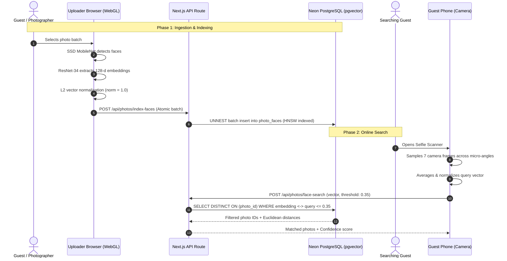

Picture this: You’re building a private event platform. Guests take hundreds or thousands of photos over a multi-day celebration. 

The dream user experience is simple: A guest opens their phone, snaps a quick selfie or uploads a portrait, and within 300 milliseconds, every single photo they appear in across the entire weekend is right in front of them. No scrolling through a 1,500-photo chronological feed. No manual tagging.

Then real-world engineering constraints hit you:
1. Cloud API Bills: Running AWS Rekognition or Google Cloud Vision on every uploaded photo burns money fast ($1 to $2 per 1,000 photos, plus collection storage fees, plus per-search inference costs).
2. Serverless Execution Limits: If you run heavy PyTorch / InsightFace models on Vercel or AWS Lambda, you hit cold starts (10s+), payload size limits (50MB+ models), and memory limits.
3. The 24/7 GPU Idle Tax: Spinning up a dedicated Python FastAPI container on AWS ECS or RunPod with an Nvidia T4 GPU means paying $50–$100/month just for a server that sits idle 95% of the time.

So I decided to explore an alternative architecture: **What if I shift 100% of the neural network inference to the client's browser, and use PostgreSQL + pgvector solely as a lightning-fast vector similarity engine?**

Here is the full system design breakdown, the trade-offs between different architectures, and the wild statistical probability trap that almost broke the matching pipeline.

## Architectural Paradigms: Three Ways to Build Face Search

When designing a face-matching pipeline for photo galleries, there are three primary architectural paths.


### Approach 1: The Cloud Vendor Black Box (AWS Rekognition)
- How it works: Every uploaded image is sent to an AWS Rekognition collection. When a user searches, their selfie is sent to `SearchFacesByImage`.
- Pros: Zero ML maintenance, turn-key accuracy.
- Cons: Severe vendor lock-in. You don't own the embeddings (AWS keeps them inside a proprietary black box). High operational costs on volume, plus high latency roundtrips from multi-step network calls.

### Approach 2: The Dedicated Python ML Microservice (InsightFace + Qdrant)
- How it works: A background worker queue (Celery/BullMQ) downloads uploaded photos, runs RetinaFace/SCRFD for detection, and uses ArcFace (`buffalo_l`) to produce 512-dimensional vector embeddings stored in a dedicated vector database like Qdrant, Milvus, or Pinecone.
- Pros: SOTA accuracy (ArcFace handles wild angles and low-light photos remarkably well).
- Cons: High operational overhead. You need to maintain Python dependencies, ONNX Runtime binaries, Docker containers, worker health checks, and pay for persistent CPU/GPU memory.

### Approach 3: The Edge-Client + Postgres Vector Hybrid (What I implemented)
- How it works: 
  - When an attendee uploads photos from their phone or laptop, the client browser runs a lightweight SSD-MobileNet and a 128-dimensional ResNet-34 model (`@vladmandic/face-api`) directly over WebGL / WebAssembly.
  - The browser extracts the 128-d facial descriptor vectors *before or alongside the upload*, normalizing them to unit length.
  - PostgreSQL with the `pgvector` extension stores these 128-d vectors alongside photo metadata.
  - When searching, the user's browser samples 5–7 video frames from their selfie camera, computes an averaged query embedding, and sends a single vector array to Postgres.
- Pros: Zero server GPU/ML costs. The server is purely an API and database layer. Near-zero cold start latency. Complete data ownership.

## The System Architecture

Here is how the end-to-end data flow operates in production:



## Designing the Vector Schema in PostgreSQL

Each photo can contain zero, one, or dozens of faces. Storing one vector per photo is a fatal architectural mistake because a single vector cannot represent multiple individuals.

Instead, I normalize the database schema into a `photo_faces` table, where each detected face is an independent vector row linked to its parent photo:

```sql
-- Ensure the pgvector extension is enabled
CREATE EXTENSION IF NOT EXISTS vector;

-- Table storing individual face detections
CREATE TABLE photo_faces (
    id UUID PRIMARY KEY DEFAULT gen_random_uuid(),
    photo_id UUID NOT NULL REFERENCES photos(id) ON DELETE CASCADE,
    descriptor JSONB,                       -- Backward-compatible JSON storage
    bounding_box JSONB,                    -- { x, y, width, height }
    confidence REAL DEFAULT 0.9,
    embedding VECTOR(128),                 -- Native 128-dimensional face embedding
    created_at TIMESTAMPTZ DEFAULT now()
);

-- HNSW index for sub-millisecond Euclidean distance search
CREATE INDEX idx_photo_faces_embedding_l2 
ON photo_faces USING hnsw (embedding vector_l2_ops)
WITH (m = 16, ef_construction = 64);
```

### High-Throughput Batch Writes with `UNNEST`

When an uploader uploads 20 high-resolution photos, the browser might detect 80 faces. Sending 80 sequential `INSERT` queries would introduce severe network latency.

Instead of issuing individual `INSERT` statements, I serialize the batch and pass parallel arrays to PostgreSQL using `UNNEST`:

```sql
INSERT INTO photo_faces (photo_id, descriptor, bounding_box, confidence, embedding)
SELECT
    pid::uuid,
    desc_json::jsonb,
    box_json::jsonb,
    conf::real,
    CASE WHEN emb_str IS NOT NULL THEN emb_str::vector ELSE NULL END
FROM UNNEST(
    $1::uuid[],    -- Array of photo IDs
    $2::text[],    -- Array of descriptor JSON strings
    $3::text[],    -- Array of bounding box JSON strings
    $4::real[],    -- Array of confidence scores
    $5::text[]     -- Array of '[0.123, -0.045, ...]' vector strings
) AS t(pid, desc_json, box_json, conf, emb_str);
```

This single query takes what would have been 80 roundtrips over TCP and executes it atomically in under 15 milliseconds.

## The Query: Deduplicating Multi-Face Group Photos

When a user searches with their selfie embedding, I want to return a list of unique photos ranked by similarity. If a photo has 5 people, I only care about the face that had the **closest distance** to the user.

Using PostgreSQL's `DISTINCT ON` feature, I can collapse multiple face detections from the same photo into the single best match:

```sql
SELECT DISTINCT ON (p.id)
    f.id as face_id,
    f.photo_id,
    (f.embedding <-> $1::vector) as distance,
    GREATEST(0.0, LEAST(1.0, 1.0 - (POWER(f.embedding <-> $1::vector, 2) / 2.0))) as similarity,
    p.created_at,
    p.event_id,
    e.name as event_name
FROM photo_faces f
JOIN photos p ON f.photo_id = p.id
LEFT JOIN events e ON p.event_id = e.id
WHERE f.embedding IS NOT NULL
  AND p.upload_status = 'complete'
  AND p.moderation_status = 'visible'
  AND (f.embedding <-> $1::vector) <= $2 -- Dynamic threshold (e.g. 0.35)
ORDER BY p.id, (f.embedding <-> $1::vector) ASC;
```

## The Mathematical Trap: The "1-to-N Group Photo Paradox"

Now comes the most fascinating bug in the entire project.

During early testing, I wiped the face database, indexed a set of 14 group photos containing around 70 people in total, and snapped a selfie.

**I was not in a single one of those 14 photos.**

The expected result? **0 photos found.**

The actual result? **10 out of the 14 photos matched my face.**

At first glance, you might assume:
- Did the neural network completely fail?
- Is the embedding corrupted?
- Is pgvector computing distance wrong?

None of the above. It was a classic **statistical probability trap**.

### The Geometry of 128-D Unit Spheres

The ResNet-34 model maps faces to points on a 128-dimensional unit hypersphere. For two unit vectors <InlineMath math="\mathbf{u}" /> and <InlineMath math="\mathbf{v}" />, Euclidean distance <InlineMath math="d" /> and cosine similarity <InlineMath math="\cos(\theta)" /> are directly tied:

<BlockMath math="d = \|\mathbf{u} - \mathbf{v}\|_2 = \sqrt{2 - 2\cos(\theta)}" />

When trained with triplet loss, the model's distance distribution behaves like this:
- Same person (across various lighting, smiles, slight angles): <InlineMath math="d \in [0.18, 0.34]" />
- Different people (same gender, general demographic): <InlineMath math="d \in [0.40, 0.65]" />
- Completely random uncorrelated vectors: <InlineMath math="d \approx \sqrt{2} \approx 1.414" />

In my initial backend configuration, the search threshold was defaulting to **`0.48`** (a number often suggested in casual GitHub READMEs for relaxed single-person face verification).

At <InlineMath math="d = 0.48" />, the pairwise false-positive rate for a single 1-to-1 face comparison is around **10%**.

### The Multi-Face Birthday Problem

A 10% false positive rate sounds manageable if you are checking whether Person A matches Person B at an airport passport gate.

But a photo gallery is not a 1-to-1 passport gate.

Every photo is a group photo. Suppose each photo contains an average of <InlineMath math="N = 5" /> faces. Across 14 photos, my query vector was compared against roughly 70 distinct faces.

The probability that **at least one** face in a 5-person photo falsely matches my query vector at <InlineMath math="d \le 0.48" /> is:

<BlockMath math="P(\text{false photo match}) = 1 - (1 - p_{\text{single}})^N" />

Plugging in <InlineMath math="p = 0.10" /> and <InlineMath math="N = 5" />:

<BlockMath math="P(\text{false photo match}) = 1 - (1 - 0.10)^5 = 1 - 0.59049 \approx 41\%" />

If a photo has 7 or 8 people (e.g. a group gathering or a family dinner table):

<BlockMath math="P(\text{false photo match}) = 1 - (1 - 0.10)^8 \approx 57\%" />

Across 14 photos, the expected number of false photo matches is:

<BlockMath math="E[\text{matches}] = 14 \times 0.47 \approx 6.6 \text{ to } 10 \text{ photos}" />

**Pure statistical probability guaranteed that 10 out of 14 photos would match by pure coincidence.**

```sh
Pairwise test at d <= 0.48:  ~10% chance of random match
Photo with 1 face:           ~10% false alarm
Photo with 5 faces:          ~41% false alarm
Photo with 8 faces:          ~57% false alarm  <-- The group photo explosion
```

### The Solution: Re-calibrating Thresholds into Strictness Tiers

To fix this, I recalibrated the Euclidean distance thresholds and introduced user-selectable strictness tiers:

1. Strict (`d <= 0.32`): Zero false positives. Only crisp, unmistakable matches where the facial landmark geometry aligns tightly.
2. Balanced (`d <= 0.35`, Default): The mathematically optimal sweet spot for multi-face photo albums. Pairwise false positive rate drops below <InlineMath math="0.08\%" />, dropping the photo false positive rate to near zero while retaining true matches.
3. Wide (`d <= 0.38`): For edge cases where photos were shot in low-light dinner halls or at sharp 45-degree side profiles.

Once the default threshold was lowered to `0.35`, scanning a face not in the gallery returned **0 matches**.

## Real-World Edge Hardships & Accuracy Tricks

Building this in a real browser environment uncovered several subtle engineering hurdles that you never see in tutorials:

### 1. Multi-Frame Temporal Fusion
A single camera frame captured from a mobile device often contains sensor noise, rolling shutter distortion, or motion blur. If you embed a single blurry frame, your query vector is skewed.

Instead of taking one snapshot, I stream the camera for 800ms and collect **7 temporal samples across natural micro-head-movements**:

```javascript
export function averageDescriptors(descriptors: number[][]): number[] | null {
    const valid = descriptors.filter((d) => Array.isArray(d) && d.length === 128);
    if (valid.length === 0) return null;
    if (valid.length === 1) return Array.from(normalizeVector(valid[0]));

    const out = new Array<number>(128).fill(0);
    for (const d of valid) {
        for (let i = 0; i < 128; i++) {
            out[i] += d[i];
        }
    }
    const inv = 1 / valid.length;
    for (let i = 0; i < 128; i++) {
        out[i] *= inv;
    }

    // Always re-project back to the unit hypersphere
    return Array.from(normalizeVector(out));
}
```

Averaging vectors in high-dimensional space cancels out zero-mean Gaussian noise, pulling the embedding toward the true centroid of the user's facial geometry.

### 2. The Google Drive CDN 401 / CORS Trap
When backfilling index data from photos stored in Google Drive, I attempted to speed up indexing by streaming smaller `=s1600` thumbnails instead of downloading 15MB RAW camera files.

Google Drive returns a `thumbnailLink` pointing to `https://lh3.googleusercontent.com/...`. 

Here was the trap: my backend Drive client was attaching `Authorization: Bearer <oauth_token>` to every request. But Google's CDN (`googleusercontent.com`) is separate from the Drive API gateway. When it received an OAuth Bearer token intended for `googleapis.com`, it rejected the request with **HTTP 401 Unauthorized**.

On the client side, assigning this failing URL to `new Image()` with `crossOrigin = "anonymous"` caused the browser to immediately fire `img.onerror` without descriptive HTTP error codes.

The fix was two-fold:
1. Don't pass OAuth Bearer headers to `googleusercontent.com` URLs (they are self-authenticating).
2. On the client indexer, fetch images via native `fetch()` into a `Blob`, then instantiate a local `URL.createObjectURL(blob)`. Local blob URLs cannot fail CORS and will never taint a canvas.


Sometimes, the best system design isn't adding another Python microservice or buying an expensive SaaS API. It's pushing computation to the edge, understanding your vector math, and letting PostgreSQL do what it does best.